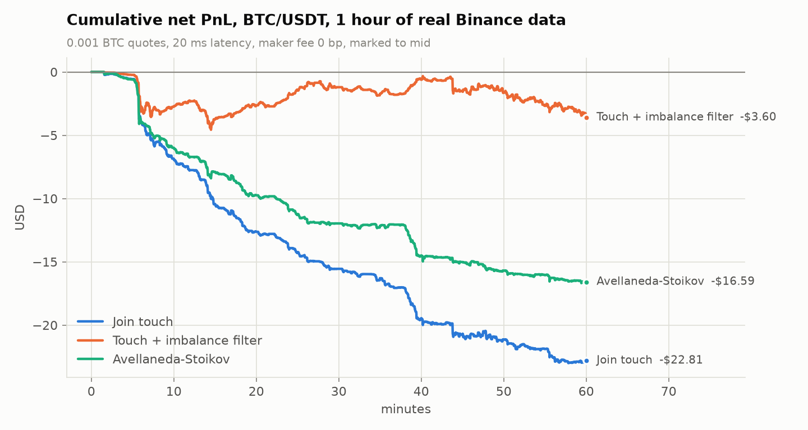
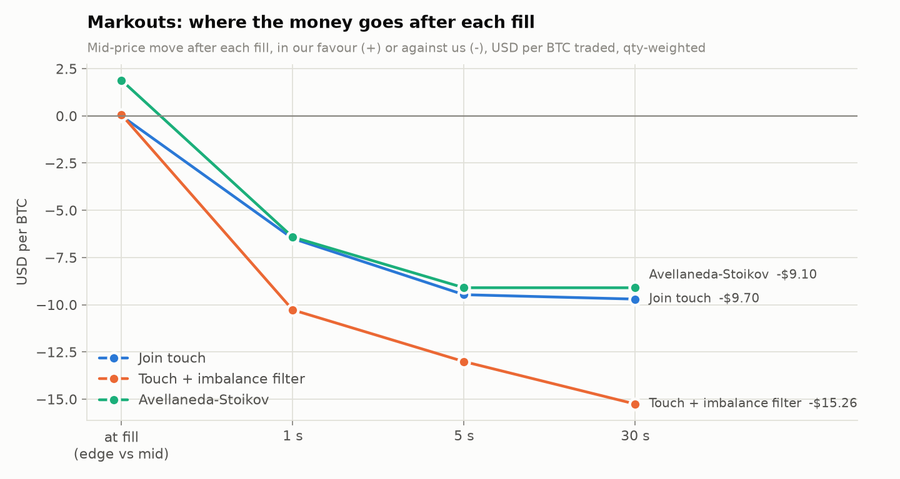
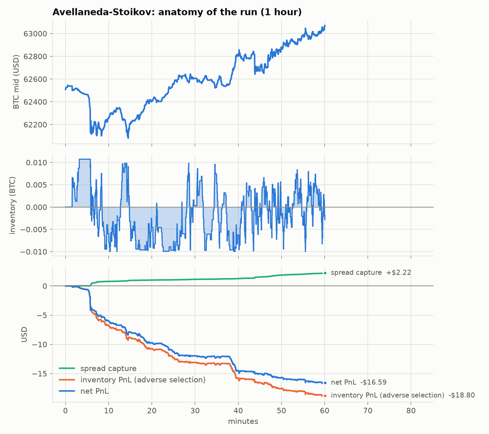
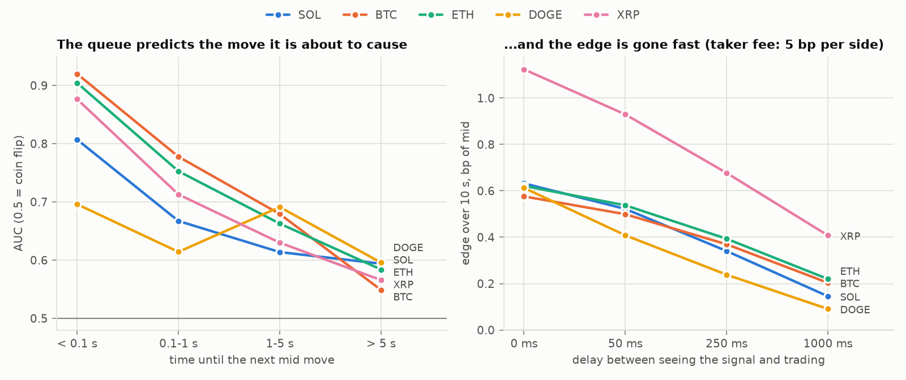

# lob-engine

A low-latency **limit order book and matching engine** in modern C++20. On top of it sits
a market-making research stack: real Binance market data replayed and validated against
the exchange, and a queue-aware backtester for Avellaneda–Stoikov market making.



- Price-time priority matching (limit, market/IOC, cancel, size reduction)
- Zero heap allocation in steady state (pooled orders + free list)
- **~51M mixed operations/s** on a single core, p99 latency **< 100 ns**
- **Replays real Binance BTC/USDT data.** The reconstructed book matched the exchange's
  own snapshots on every check: 17 of 17 checkpoints, 160,187 price levels.
- **Market-making backtest on one hour of real data.** Avellaneda–Stoikov, a
  join-the-touch baseline and an imbalance filter all lose about 2 bp per unit traded to
  adverse selection, and the backtester shows exactly why ([findings](#phase-3-market-making-backtest)).
- **Research study on 381M real order-book updates.** Queue imbalance predicts the next
  price move on 5 Binance perpetuals, out of sample and in 2 market regimes (AUC up to
  0.76). It still cannot pay a taker: the edge is about 20 times smaller than the fees
  and decays within milliseconds ([study](docs/research/README.md)).
- Verified against a naive reference implementation on 200k random operations
- CI on Linux (GCC) and macOS (Clang), plus an AddressSanitizer/UBSan job. The CI also
  replays real market data and fails if the book drifts.

## Results

Measured on an Apple M5, Release build (`-O3`), single thread, 2M-event synthetic order
flow (55% limit, 40% cancel, 5% market; random-walk mid; orders clustered near the touch).

**Throughput** (`build/lob_bench`, Google Benchmark)

| Benchmark | Time | Throughput |
|---|---|---|
| Mixed order flow (1M events) | 19.7 ms | **50.9M ops/s** |
| Add + cancel near top of book | 23.7 ns / pair | 84.4M ops/s |
| Build 10 levels + sweep with one market order | 192 ns | 57.2M ops/s |

**Per-operation latency** (`build/lob_latency`, ns)

| Op | p50 | p90 | p99 | p99.9 |
|---|---|---|---|---|
| limit | 41 | 42 | 83 | 167 |
| market | 41 | 42 | 84 | 167 |
| cancel | ≤ 42 | 42 | 42 | 125 |

> On Apple Silicon `steady_clock` ticks at 24 MHz (~42 ns), so latency percentiles are
> quantised to that resolution; most operations actually complete in a fraction of a tick.
> On Linux x86-64 the clock resolution is ~1 ns.

## Real market data: Binance L2 replay

```
 Binance websocket ──► record.py ──► raw .jsonl.gz ──► convert.py ──► .lob ──► lob_replay
 (depth@100ms, trades)  (+ REST snapshots)  (source of truth)  (sync protocol,  (binary,   (engine + checks
                                                                integer ticks)   40 B/rec)  vs exchange)
```

Result on the bundled 5-minute sample (`data/sample/btcusdt_sample.jsonl.gz`):

```
BTCUSDT  tick 0.01  lot 1e-05  |  5.1 min of market data
depth events   2979  (49763 level updates)
trades         3608  (47.86207 BTCUSDT)
resets         1
crossed fixes  0
replay         9.76 ms  (10.9M records/s, 3276 ns per depth event)
checkpoints    5/5 matched  (49846 levels compared)
```

**How correctness is established.** The recorder captures the diff-depth stream and,
every minute, a full 5000-level REST snapshot. `convert.py` implements Binance's sync
protocol (drop stale events, check that `U <= lastUpdateId+1 <= u`, then require
`U == prev_u + 1`, and resync from a snapshot when there is a gap). It then places each
checkpoint snapshot at its exact update id. If an event straddles that id, the prices
it touches are excluded from the comparison, because they cannot be compared exactly.
`lob_replay` then compares its reconstructed book with the exchange's snapshot, level by
level. Any mismatch makes it exit non-zero, and CI runs it on every push.

**From L2 to an order-by-order book.** Binance publishes aggregated quantity per price
level, so `L2BookBuilder` represents each level as a FIFO of synthetic orders. Increases
join the back of the queue and decreases trim the newest liquidity first. This keeps a
meaningful queue position for the market-making simulator (phase 3). Each exchange event
is applied atomically: decreases first, then increases from the worst price to the best.
That order never creates a crossed intermediate state, so replayed liquidity never trades
against itself. Prices and quantities are converted to integer ticks and lots with exact
decimal arithmetic.

**What profiling real data revealed.** With synthetic flow concentrated at the touch, the
engine runs at ~20 ns/op. Real Binance updates hit the whole 5000-level book, so deep
level inserts shift memory (~25% of replay time). The L2 adapter's per-level allocations
cost about another 25%. At ~3 µs per 100 ms exchange event, replay runs about 30,000×
faster than real time, which is fast enough for multi-day backtests. These two costs are
the next optimisation targets.

## Phase 3: market-making backtest

The strategy's own orders are simulated against the replayed market (`include/lob/sim/`).
A market-making backtest is only as credible as its fill model, so the fill model is
explicit and tested (`tests/test_sim.cpp`):

| Assumption | Model |
|---|---|
| Latency | New orders and cancels take effect 20 ms after they are sent. An order can still fill while its cancel is in flight. |
| Post-only | An order that would cross the market on arrival is rejected. |
| Queue position | A new order joins **behind** the quantity already resting at its price. Liquidity added later queues behind it. |
| Fills at our price | Real trades at our price consume the queue ahead of us first, then fill us. |
| Fills through our price | If a sell prints *below* our bid, it would have hit us first, so we fill up to the trade size. |
| Cancels by others | Assumed to come from behind us first (the same FIFO model as the L2 adapter), so the queue ahead only shrinks when the level drops below it. This is conservative. |
| Not modelled | Market impact (our fills don't remove real liquidity). Orders are only re-evaluated on market events. |

**Strategies.**
- **Avellaneda–Stoikov (2008)** with a rolling horizon: reservation price
  `r = s − q·γ·σ²·τ` and spread `γ·σ²·τ + (2/γ)·ln(1 + γ/k)`. σ² is estimated online
  (time-weighted EWMA of mid variance). k is estimated online from the distance of trade
  prints to the mid (exponential MLE). As an option, it can use the size-weighted
  microprice instead of the mid.
- **Join touch.** The baseline always quotes the best bid and the best ask.
- **Touch + imbalance filter.** It steps away from the side whose queue is about to be
  depleted (queue imbalance < 0.25).

All strategies quote 0.001 BTC, cap inventory at ±0.01 BTC, and keep an unchanged quote in
place so it keeps its queue priority.

### Results: 1 hour of BTC/USDT, 133,512 trades, 0 bp fees

| Strategy | Fills | Volume | Spread capture | Inventory PnL | **Net PnL** | Markout 1 s | Markout 30 s | Break-even maker fee |
|---|---:|---:|---:|---:|---:|---:|---:|---:|
| Join touch (baseline) | 12,967 | 1.87 BTC | +$0.01 | −$22.81 | **−$22.81** | −$6.49/BTC | −$9.70/BTC | −1.95 bp |
| Touch + imbalance filter | 1,441 | 0.24 BTC | +$0.02 | −$3.62 | **−$3.60** | −$10.27/BTC | −$15.26/BTC | −2.43 bp |
| Avellaneda–Stoikov γ=1e-4 | 5,642 | 1.16 BTC | +$2.15 | −$18.68 | **−$16.52** | −$6.31/BTC | −$8.81/BTC | −2.27 bp |
| AS γ=1e-4 + microprice | 5,710 | 1.17 BTC | +$2.22 | −$18.80 | **−$16.59** | −$6.42/BTC | −$9.10/BTC | −2.26 bp |
| AS γ=1e-3 | 4,848 | 0.95 BTC | +$2.05 | −$16.84 | **−$14.79** | −$6.36/BTC | −$10.99/BTC | −2.49 bp |

*Spread capture* is the edge against the mid at the moment of each fill. *Inventory PnL*
is the mid moving on the inventory we hold, which is where adverse selection shows up.
*Break-even maker fee* is the fee at which net PnL would be zero: a negative value means
the strategy needs a rebate that large just to break even. Run
`./build/lob_mm_backtest <file.lob> --sweep` for the full grid, including latency
sensitivity.



### What the data says

1. **No variant makes money. Every one loses about 2 bp of notional to adverse
   selection.** The inventory loss is about 9× the spread captured for
   Avellaneda–Stoikov, and the touch strategies capture almost nothing at all. Real
   maker fees at Binance's standard spot tiers are positive, which would only widen the
   loss.
2. **Fills arrive exactly when they hurt.** 82–99% of fills happen because the price
   traded *through* our level. BTC/USDT is a large-tick market: the spread is pinned at
   one tick ($0.01) and the touch holds several BTC, so a quote at the touch only fills
   once the whole queue ahead is consumed. That is precisely the moment the mid jumps.
   The average fill is followed by a ≈$6.5/BTC move against us within one second, while
   the spread offers $0.005.
3. **Avellaneda–Stoikov behaves as designed but cannot change the sign.** Its inventory
   skew works (lower mean |inventory| as γ rises). Quoting deeper earns real edge at the
   fill (+$1.9/BTC versus ≈$0 at the touch), but that edge is about 3× smaller than the
   one-second markout.
4. **The imbalance filter cuts losses 6× by trading about 8× less volume.** It does not find better
   fills: the fills it keeps are *more* toxic per BTC (−$10.3 versus −$6.5 at 1 s).
5. **Latency is not the bottleneck; information is.** Going from 100 ms to 1 ms of
   order latency changes little and never flips the sign (see `--sweep`), because the strategy acts on a public depth feed that
   updates every 100 ms. Any quote can be up to 100 ms stale and gets picked off. In this
   market, profitability depends on data speed and queue priority, not on the quoting
   formula. Testing that hypothesis with Binance's real-time `bookTicker` feed is the
   next research step.



**Limitations.** One hour is a single market regime (BTC drifted up about $500), so these
results are not a statistically robust strategy evaluation. Our quotes have no market
impact. During a cancel-replace, the old and new orders briefly coexist, which can push
inventory one order past its limit (visible above).

## Research: queue imbalance as a price predictor

[Full study](docs/research/README.md). It applies the design of Gould & Bonart (2016) to
Binance USD-M perpetuals: 5 contracts, 2 regimes (Sep 2023 and Mar 2024), 381M top-of-book
updates and 2.5M samples, with out-of-sample tests and block-bootstrap intervals.

- **The signal is real.** Out-of-sample AUC is 0.63 to 0.76, and the side with the bigger
  queue wins the next move 59.5 to 68.8% of the time. A model fitted on a quiet day keeps
  its calibration in a crash week.
- **It predicts the move it is about to cause.** When the next move comes within 100 ms,
  the AUC reaches 0.92 on BTC; when it is more than 5 s away, the AUC falls to about 0.55.
  This explains most of the differences between contracts.
- **A taker cannot trade it.** On BTC and ETH, crossing the spread 50 ms after the signal
  earns +0.47 bp gross per round trip [95% CI 0.43 to 0.51], against 10 bp of fees. The
  break-even fee is 0.23 bp per side. On XRP and DOGE, one tick (1.6 to 2.1 bp) already
  costs more than the predicted move. A placebo test (the imbalance from one hour
  earlier) gives an edge of about 0.
- **Its value is defensive.** A bid resting in the thin queue sees the price fall next 67
  to 76% of the time. This is the adverse selection measured in Phase 3.



The pipeline is `tools/research/fetch_bookticker.py` (download and checksum check), then
the C++ extractor `tools/bbo_extract.cpp` (about 2M rows/s, exact integer prices), then
`tools/research/queue_imbalance.py` (statistics and charts). It is tested against an
independent implementation in CI.

## Design

```
            bids_ (ascending)                       asks_ (descending)
   [ 9995 | 9997 | 9998 | 9999 ]  best ->  <- best  [ 10004 | 10002 | 10001 ]
                           │                                           │
                    Level{price, qty, head, tail}                     ...
                           │
             pool_[3] <-> pool_[17] <-> pool_[5]     FIFO of orders (intrusive list)
```

| Choice | Why |
|---|---|
| Integer tick prices | Exact comparisons, no floating point on the hot path. |
| Contiguous order pool + free list | Orders are recycled, so there is no `new`/`delete` per order and memory stays cache-friendly. |
| Intrusive doubly linked FIFO per level (32-bit indices) | O(1) append, O(1) cancel from anywhere in the queue, and indices are half the size of pointers. |
| Sorted `std::vector` of levels, **best price at `back()`** | Nearly all activity happens at the top of book, so fills `pop_back()` and inserts near the touch move almost no memory. It beats a node-based `std::map` on cache behaviour. |
| Trade callback as a template parameter | It gets inlined, with no `std::function` and no virtual dispatch. |

**Known trade-offs.** Opening a new level far from the touch costs O(levels) memmove.
It shows in the 100-level sweep benchmark and in real-data replay (see above).
`std::unordered_map` is used for the id → order index; it is the next hotspot to replace
(see roadmap).

## Correctness

- **Unit tests** cover price-time priority, partial fills, not trading through a limit
  price, IOC semantics, cancels in the middle of a queue, size reductions that keep
  priority, invalid input and pool recycling.
- **Differential testing.** `tests/test_reference_model.cpp` runs 4 seeds × 50k random
  operations against a deliberately simple `std::map<Price, std::deque>` implementation.
  It asserts identical trade sequences, identical full-depth snapshots and a never-crossed
  book after every operation.
- **Sanitizers.** The full suite also runs under ASan + UBSan in CI.

## Build

Requires CMake ≥ 3.20 and a C++20 compiler (GCC 11+, Clang 14+). GoogleTest and Google
Benchmark are fetched automatically.

```bash
cmake -S . -B build -DCMAKE_BUILD_TYPE=Release
cmake --build build -j
ctest --test-dir build --output-on-failure   # tests
./build/lob_bench                            # throughput
./build/lob_latency                          # latency percentiles
./build/basic_usage                          # small demo
```

Sanitizer build: `cmake -S . -B build-asan -DCMAKE_BUILD_TYPE=Debug -DLOB_SANITIZE=ON`

**Replay the bundled real-data sample** (Python 3.9+, standard library only):

```bash
python3 tools/binance/convert.py data/sample/btcusdt_sample.jsonl.gz build/sample.lob
./build/lob_replay build/sample.lob --bbo build/bbo.csv   # also dumps best bid/offer per event
python3 -m unittest discover -s tools/binance             # sync-protocol tests
```

**Market-making backtest** on the bundled one-hour recording:

```bash
python3 tools/binance/convert.py data/btcusdt_1h.jsonl.gz build/btcusdt_1h.lob
./build/lob_mm_backtest build/btcusdt_1h.lob --sweep                 # comparison grid
./build/lob_mm_backtest build/btcusdt_1h.lob --strategy as --gamma 1e-4 --microprice \
    --fee-bps 0 --latency-ms 20 --out build/as                         # one run + CSVs
python3 -m venv .venv && .venv/bin/pip install -r tools/analysis/requirements.txt
.venv/bin/python tools/analysis/plot_backtest.py build/btcusdt_1h.lob --out docs/img
```

**Record your own data** (public market-data endpoints, no API key):

```bash
python3 -m venv .venv && .venv/bin/pip install -r tools/binance/requirements.txt
.venv/bin/python tools/binance/record.py --symbol BTCUSDT --minutes 30 --out data/btcusdt.jsonl.gz
```

## Usage

```cpp
#include "lob/order_book.hpp"

lob::OrderBook book;
book.add_limit(1, lob::Side::Sell, 10'001, 25);
book.add_limit(2, lob::Side::Sell, 10'002, 40);

auto r = book.add_limit(3, lob::Side::Buy, 10'002, 50, [](const lob::Trade& t) {
    // t.maker_id, t.taker_id, t.price, t.qty
});
// r.filled == 50, r.rested == 0, book.best_ask() == 10'002

book.cancel(2);
```

## Roadmap

- [x] **Phase 1: matching engine.** Order book, tests, benchmarks, CI.
- [x] **Phase 2: market data.** Record Binance L2 and trades, replay them deterministically, and validate the book against exchange snapshots.
- [x] **Phase 3: market making.** Queue-aware simulated execution, Avellaneda–Stoikov with online σ and k estimation, baselines, PnL decomposition and markout analysis on one hour of real data.
- [ ] **Phase 3b: information speed.** Record the real-time `bookTicker` feed and test whether faster data turns the adverse-selection loss around.
- [x] **Research: queue imbalance.** A predictive study on 6 days of Binance top-of-book data for 5 contracts. The signal is real; for a taker it is not tradable after fees.
- [ ] **Phase 4: analytics.** `pybind11` bindings and a notebook for interactive research (the static charts above come from `tools/analysis/plot_backtest.py`).
- [ ] **Performance.** Faster deep-level inserts (a tick-indexed ladder or a hybrid of both structures), an allocation-free L2 adapter, an open-addressing id index, `rdtsc`/`cntvct` cycle timing, and huge pages plus core pinning on Linux.

## License

MIT
