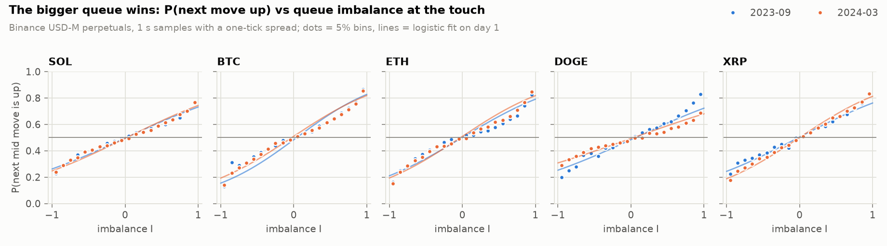
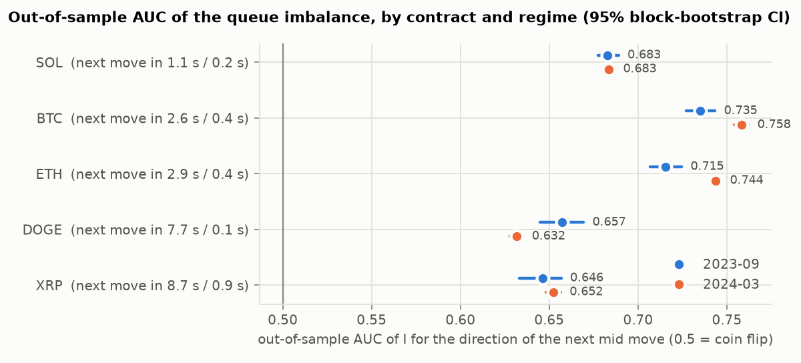
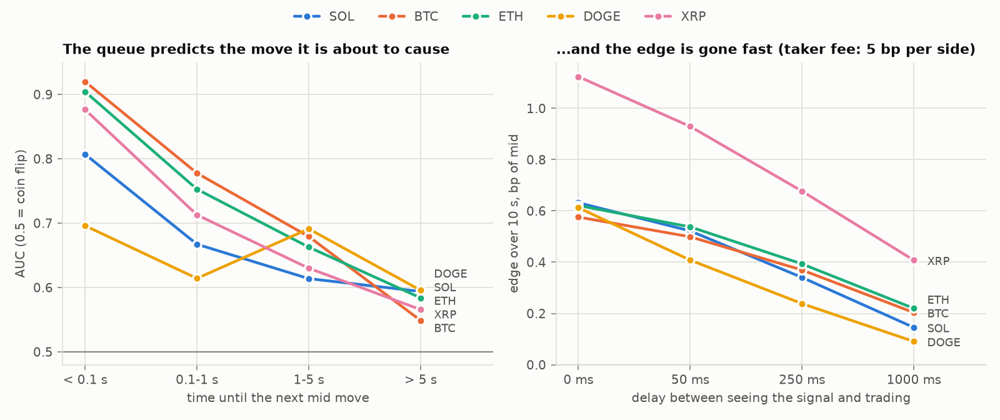

# Queue imbalance on Binance perpetuals: a real predictor that a taker cannot trade

**Question.** At the best bid and ask, does the relative size of the two queues predict
the direction of the next mid-price move on crypto perpetual futures? If it does, is the
signal worth money after trading costs?

**Short answer.** It predicts the move clearly: out-of-sample AUC is 0.63 to 0.76 across
5 contracts and 2 market regimes. The fitted model is stable from day to day and transfers
between regimes. But a taker cannot monetise it. The best gross edge is about 0.5 bp per
round trip, against 10 bp of standard taker fees, and that edge loses a third of its value
in the first quarter of a second. The signal pays off for whoever **provides** liquidity:
a resting bid in the thin queue sees the price fall next 67 to 76% of the time. That is
the adverse selection measured in the [market-making backtest](../../README.md#phase-3-market-making-backtest).



## Design

The design follows Gould & Bonart (2016), *Queue imbalance as a one-tick-ahead price
predictor in a limit order book*, Market Microstructure and Liquidity 2(2), applied to
crypto perpetuals.

- **Data.** Binance USD-M futures daily `bookTicker` archives: every change of the best
  bid and ask, with quantities and matching-engine timestamps, from
  [data.binance.vision](https://data.binance.vision). Every file is SHA-256 verified.
  - Contracts: BTCUSDT, ETHUSDT, SOLUSDT, XRPUSDT, DOGEUSDT.
  - Two regimes, three days each: a quiet market (11 to 13 September 2023, BTC near
    $26k) and a hot one (4 to 6 March 2024, BTC at an all-time high around $68k,
    including the 5 March flash crash).
  - 30 files, 381M book updates.
- **Processing.** A C++ streaming extractor (`tools/bbo_extract.cpp`, about 2M rows/s)
  parses the CSV exactly, keeping prices as integers in units of 1e-8.
  - It samples the book on a 1-second clock and keeps every change of the best prices.
  - Data quality checks: 295 rows quoting off the price tick were dropped (out of 381M).
    There were no crossed books, no out-of-order timestamps and no regressions in update
    ids.
  - The output is cross-checked against an independent Python implementation in the
    tests.
- **Feature.** `I = (Vb - Va) / (Vb + Va)` at the touch, in [-1, 1]. It is used only when
  the spread is exactly one tick, which is 85 to 100% of the time on these contracts.
- **Target.** Whether the next change of the mid is up or down.
- **Model and protocol.** A logistic regression `P(up) = σ(a + b·I)` is fitted on the
  first day of each regime and tested on the next two days, which keeps the test out of
  sample in time. The day-1 model is then also scored on the other regime, to test
  whether it carries over.
- **Uncertainty.** All intervals are 95% moving-block bootstrap intervals, with 5-minute
  blocks and 300 resamples. Consecutive samples often share the same next move, so a
  naive interval would be too narrow.

## 1. The signal is real, stable, and transfers between regimes

| contract | AUC, Sep 2023 | AUC, Mar 2024 | sign(I) right, Sep / Mar | slope b, day by day (Sep; Mar) |
|---|---|---|---|---|
| BTC | 0.735 [0.727, 0.743] | 0.758 [0.754, 0.762] | 66.8% / 68.8% | 1.63 1.40 1.41; 1.47 1.39 1.59 |
| ETH | 0.715 [0.707, 0.724] | 0.744 [0.741, 0.747] | 65.1% / 67.6% | 1.33 1.33 1.17; 1.47 1.37 1.46 |
| SOL | 0.683 [0.677, 0.689] | 0.683 [0.681, 0.687] | 63.3% / 63.4% | 1.02 1.04 1.01; 1.09 1.06 1.04 |
| DOGE | 0.657 [0.645, 0.669] | 0.632 [0.628, 0.635] | 61.4% / 59.5% | 1.02 1.08 1.20; 0.78 0.72 0.76 |
| XRP | 0.646 [0.633, 0.657] | 0.652 [0.648, 0.656] | 60.7% / 60.6% | 1.15 1.21 1.03; 1.47 1.32 1.38 |

- **The rule "the side with the bigger queue wins" is right 59.5 to 68.8% of the time,**
  against 50% by chance.
- **The calibration is close to linear in I** over most of its range (chart above).
- **Calibration transfers between regimes.** The BTC model fitted on a quiet September
  day scores a pseudo-R² of 0.150 on March, against 0.151 for March's own model.
- **DOGE is the exception.** Its slope drops from about 1.1 in September to about 0.75 in
  March, and its touch depth fell from $28k to $2.8k.



## 2. What drives the differences: the queue predicts the move it is about to cause

Split by how long the market takes to make its next move, the predictive power collapses
with the wait. This table is a diagnostic only: it conditions on the future, so it is not
a usable model.

| contract | next move < 0.1 s | 0.1–1 s | 1–5 s | > 5 s |
|---|---:|---:|---:|---:|
| BTC | **0.920** (17%) | 0.778 | 0.679 | 0.549 (18%) |
| ETH | **0.904** (17%) | 0.753 | 0.663 | 0.584 (19%) |
| XRP | **0.876** (7%) | 0.713 | 0.630 | 0.566 (36%) |
| SOL | 0.807 (24%) | 0.667 | 0.614 | 0.594 (8%) |
| DOGE | 0.696 (25%) | 0.614 | 0.691 | 0.596 (34%) |

When the next move is imminent, the thin queue is the one being consumed, and the
imbalance is close to a certainty (AUC 0.92 on BTC). When the next move is seconds
away, the queues are rebuilt in the meantime and the snapshot says little.

This explains a large part of the ranking. XRP looks weak overall only because 36% of its
samples wait more than 5 s, but on imminent moves it is as predictable as BTC. It does
not explain everything: SOL and DOGE stay below BTC and ETH even at equal wait.

A plausible hypothesis, not tested here, is that their touch queues are 10 to 100 times
smaller ($3k to $12k against $130k to $400k). Such small queues are refilled and
cancelled constantly, which would make the snapshot noisier. Testing it needs trade data
(queue depth relative to trade size), which this data set does not include.

## 3. Is it tradable? Not by crossing the spread

A taker rule: when |I| > 0.8, cross the spread in the direction of I 50 ms after the
signal, then cross back 10 s later. All values are in bp of the mid, on the test days of
both regimes.

| contract | signal on | edge (mid to mid) | gross after the spread [95% CI] | net after 2 × 5 bp fees | break-even taker fee per side |
|---|---:|---:|---|---:|---:|
| BTC | 32% of the time | +0.50 | +0.47 [+0.43, +0.51] | −9.53 | 0.23 bp |
| ETH | 31% | +0.54 | +0.49 [+0.45, +0.53] | −9.51 | 0.24 bp |
| SOL | 31% | +0.52 | +0.17 [+0.12, +0.23] | −9.83 | 0.09 bp |
| DOGE | 18% | +0.41 | −0.62 [−0.74, −0.49] | −10.62 | n/a |
| XRP | 8% | +0.93 | −0.95 [−1.06, −0.85] | −10.95 | n/a |

- **On BTC and ETH, the edge survives the spread but not the fees.** The tick is tiny in
  relative terms (0.015 to 0.06 bp), so the spread costs almost nothing. The leftover
  edge, about 0.47 bp, is roughly 20 times smaller than the standard taker fee for a round
  trip. The break-even fee is 0.23 bp per side; even Binance's top regular VIP tier
  charges about 1.7 bp.
- **On XRP and DOGE, the tick itself is the cost.** XRP has the largest predicted move
  (0.93 bp), but one tick is 1.6 to 2.1 bp, so crossing the spread already loses money.
  This is the large-tick trade-off: the bigger the tick, the more predictable the next
  move, and the more expensive it is to act on it.
- **The edge decays quickly** (right panel below). On BTC, it falls from 0.58 bp when
  acting instantly to 0.50 bp at 50 ms, 0.37 bp at 250 ms and 0.20 bp at 1 s. It is
  an edge measured in milliseconds.
- **Placebo check.** Using the imbalance from one hour earlier, with the same rule, gives
  an edge between −0.04 and +0.07 bp. The effect does not come from trends in the
  sample.



## 4. What it means for a market maker

| contract | P(next move down) when our bid is in the thin queue (I < −0.5) | in the thick queue (I > 0.5) |
|---|---:|---:|
| BTC | **75.9%** | 24.0% |
| ETH | **74.9%** | 26.6% |
| SOL | **69.7%** | 30.9% |
| XRP | **68.9%** | 28.8% |
| DOGE | **66.7%** | 34.1% |

A bid resting in the thin queue gets filled precisely when that queue is consumed, and
the price then ticks down. This is the adverse selection that sank every strategy in the
[one-hour market-making backtest](../../README.md#phase-3-market-making-backtest). There,
a simple filter that steps away from the thin side cut the loss from $22.81 to $3.60.

The signal does not pay a taker; its value is defensive, for a maker deciding which side
to quote. That matches the economics of the venue: makers pay 2 bp, and the edge is far
too small to pay for crossing the spread.

## Limitations

- **Coverage.** 6 days, 5 contracts, 2 regimes: enough for tight intervals and a
  stability check, not for claims about every market condition. Binance stopped
  publishing futures `bookTicker` archives after March 2024. Newer data would have to be
  recorded live, which `tools/binance/record.py` can be adapted to do.
- **Top of book only.** There is no information on deeper levels or trades, so
  multi-level imbalance and order-flow imbalance (Cont, Kukanov & Stoikov 2014) are not
  tested.
- **Sampling.** Samples are taken on a 1-second clock rather than at every book event.
  This weights calm and busy periods equally in time, and avoids letting bursts of
  updates dominate the sample. The event-time version is a natural extension.
- **Simplified taker test.** It assumes our order is small enough to fill entirely at the
  touch, with no market impact, and a fixed latency. Hit rate counts "no move" as a miss.

## Reproduce

```sh
cmake --build build --target lob_bbo_extract
python3 -m venv .venv && .venv/bin/pip install -r tools/research/requirements.txt
.venv/bin/python tools/research/fetch_bookticker.py --out data/raw \
    --symbols BTCUSDT ETHUSDT SOLUSDT XRPUSDT DOGEUSDT \
    --dates 2023-09-11 2023-09-12 2023-09-13 2024-03-04 2024-03-05 2024-03-06   # ~4 GB
.venv/bin/python tools/research/queue_imbalance.py      # ~4 min first run, then ~1 min
```

The complete tables are in [`results.md`](results.md) and the raw numbers in
[`results.json`](results.json). The pipeline tests are in
`tools/research/test_queue_imbalance.py`.
